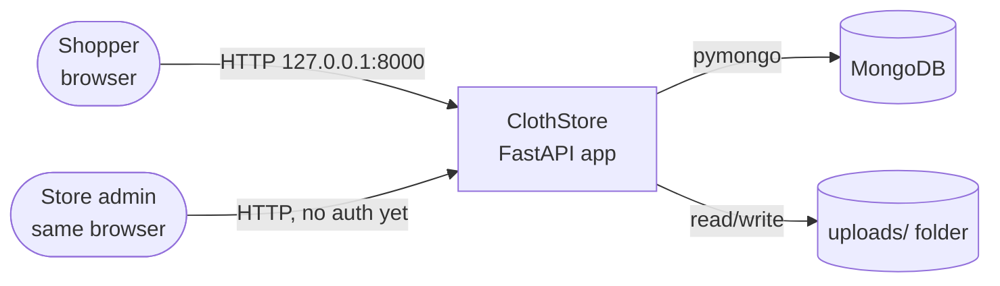
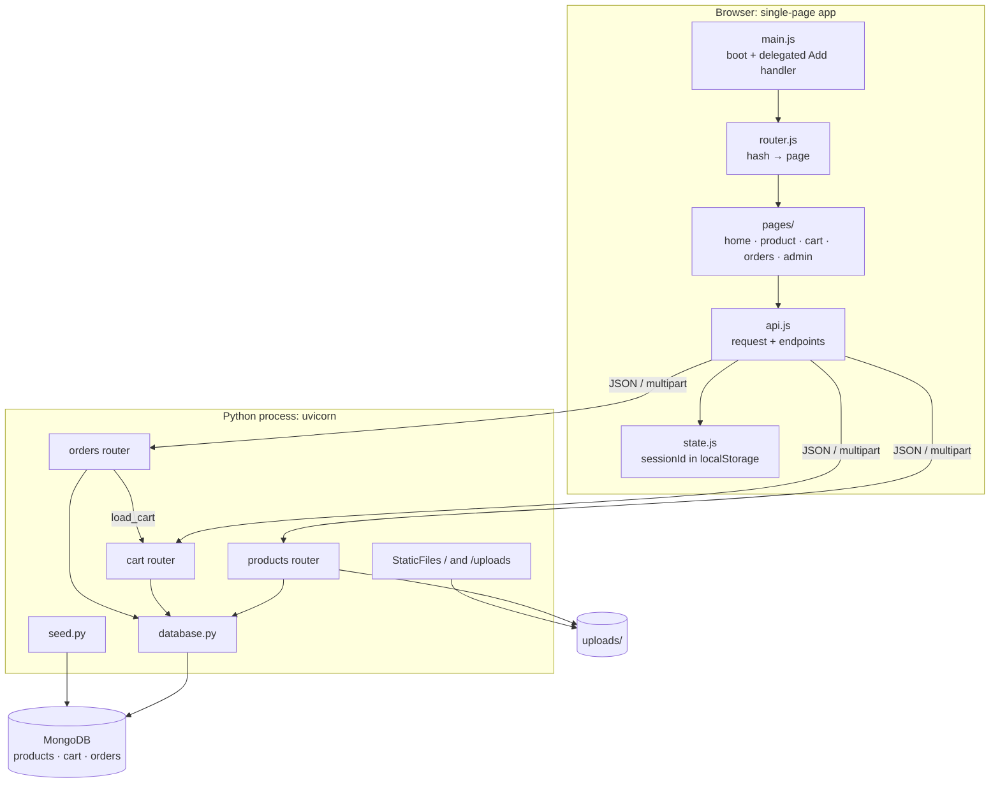
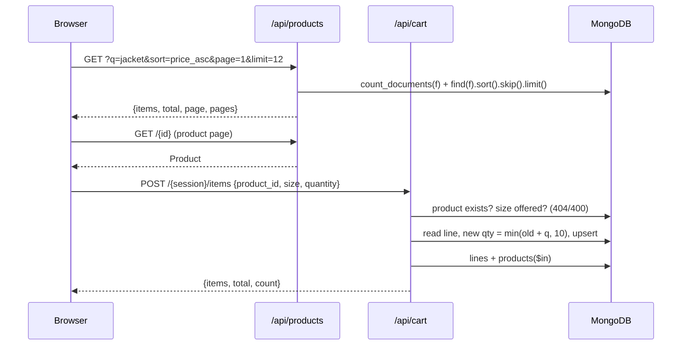
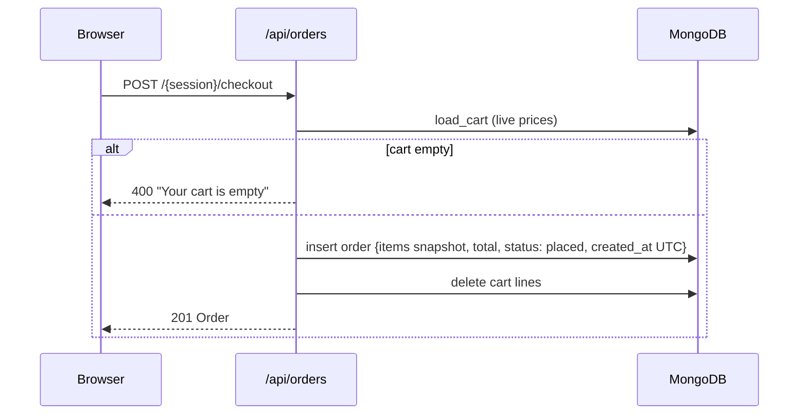

# High-Level Design

---

## 1. Purpose and scope

ClothStore demonstrates a complete, production-shaped web application that a single engineer can run, read and explain end to end: catalogue browsing, cart, checkout, order history, an admin back office, and an LLM shopping assistant that converts natural language into a safe, structured database query.

---

## 2. System context

The OpenAI Image API is used **once, offline from the app**, to create the photos. The running store never calls it.

---

## 3. Architecture

**One process, one origin.** FastAPI serves the API under `/api` and the storefront and photos under `/`. There is no CORS configuration and the frontend uses relative URLs.

## 4. Key flow

### 4.1 Browse → product → cart

### 4.2 Checkout

---

## 5. Data design

| Collection   | Document                                                                                      | Written by                           | Read by                        |
| ------------ | --------------------------------------------------------------------------------------------- | ------------------------------------ | ------------------------------ |
| `products` | `{name, description, price, category, sizes[], colors[], image}`                            | seed, admin create/update/reset      | list, detail, cart join, admin |
| `cart`     | `{session_id, product_id, size, quantity}`                                                  | add, set-quantity, checkout (delete) | cart, checkout                 |
| `orders`   | `{session_id, items[{product_id, name, price, size, quantity}], total, status, created_at}` | checkout                             | order history                  |

---

## 6. Technology decisions

| Concern          | Choice                                                      | Reason                                                                                                   |
| ---------------- | ----------------------------------------------------------- | -------------------------------------------------------------------------------------------------------- |
| File uploads     | `python-multipart` + local `uploads/` + `StaticFiles` | Standard browser form uploads. Files stay outside the database, so documents stay small. Works offline.  |
| Image validation | Magic-byte sniffing                                         | The client's filename and `Content-Type` are untrusted, while the file's first bytes are hard to fake. |
| Shopper identity | Random UUID in `localStorage`                             | Lets the shop run without accounts. Enough for a single-machine demo.                                    |
| Client routing   | Hash routes (`#/cart`)                                    | No server routing needed, and Back/Forward and deep links work.                                          |
| Pagination       | `skip`/`limit` with a total count                       | Simple, and adequate for small catalogues.                                                               |

---
