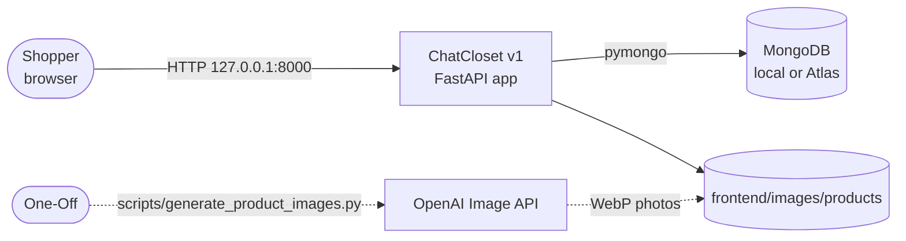
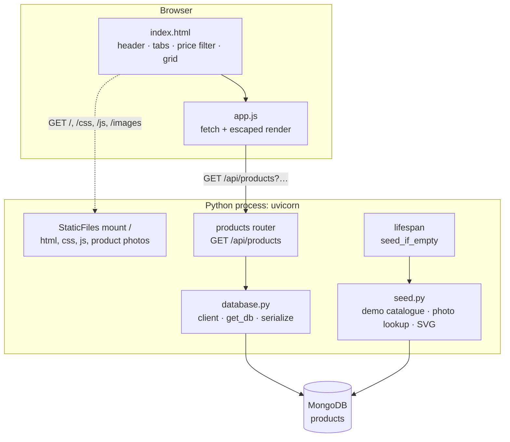
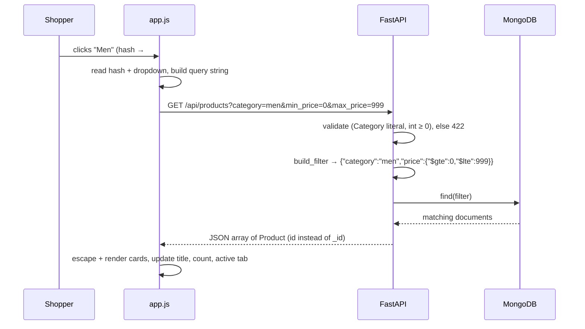

# High-Level Design

---

## 1. Purpose and scope

ClothStore demonstrates a complete, production-shaped web application that a single engineer can run, read and explain end to end: catalogue browsing, cart, checkout, order history, an admin back office, and an LLM shopping assistant that converts natural language into a safe, structured database query.

---

## 2. System context

The OpenAI Image API is used **once, offline from the app**, to create the photos. The running store never calls it.

---

## 3. Architecture

**One process, one origin.** FastAPI serves the API under `/api` and the storefront and photos under `/`. There is no CORS configuration and the frontend uses relative URLs.

## 4. Key flow: filter the catalogue

---

## 5. Data design

A single collection, `products`, holds one document per product:
`{_id, name, description, price:int, category, sizes[], colors[], image}`.

* Prices are whole rupees (`int`), so there are no floating-point rounding issues.
* `image` is a short URL path to a static WebP photo (`/images/products/casual-mustard-frock.webp`), or an inline SVG data URL when no photo exists.

---

## 6. Technology decisions

| Concern   | Choice                           | Rationale                                                                                             |
| --------- | -------------------------------- | ----------------------------------------------------------------------------------------------------- |
| API       | FastAPI                          | Typed parameters give validation and OpenAPI docs. Dependency injection makes the database swappable. |
| Database  | MongoDB (pymongo)                | Products are natural documents with embedded lists. Atlas or local through one URI.                   |
| Frontend  | Vanilla JS + CSS grid            | No toolchain. About 50 lines cover fetch, render and events.                                          |
| Images    | Static WebP files + SVG fallback | Small documents, cacheable files, offline-capable.                                                    |
| Packaging | uv + pyproject.toml + uv.lock    | Reproducible installs with pinned versions.                                                           |
| Tests     | pytest + TestClient + mongomock  | Real HTTP semantics without a database server.                                                        |

---

