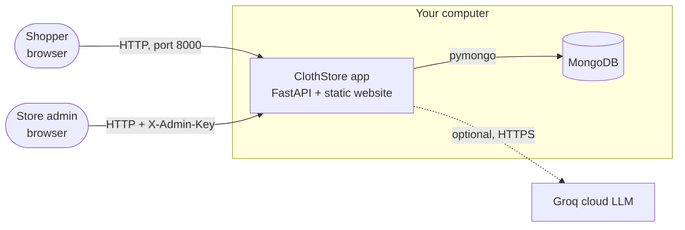
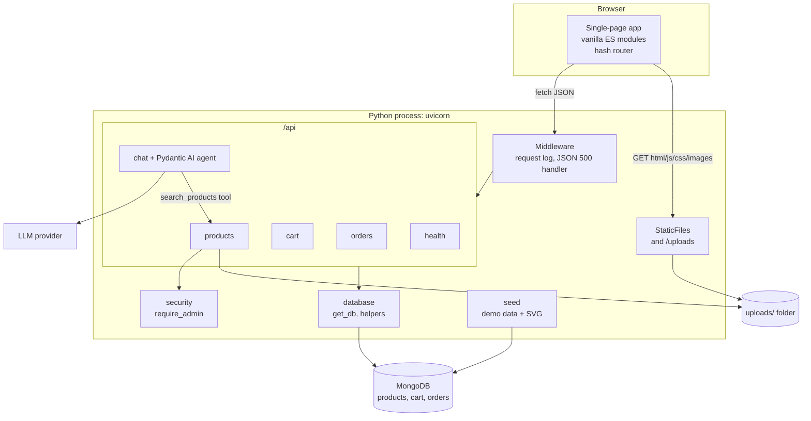
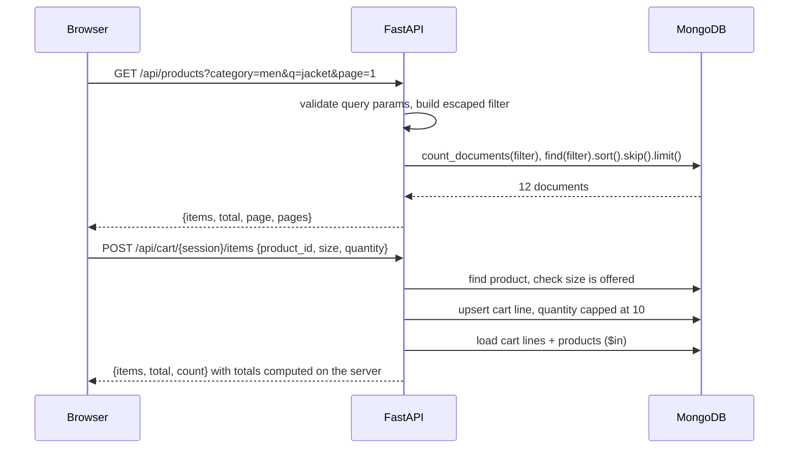
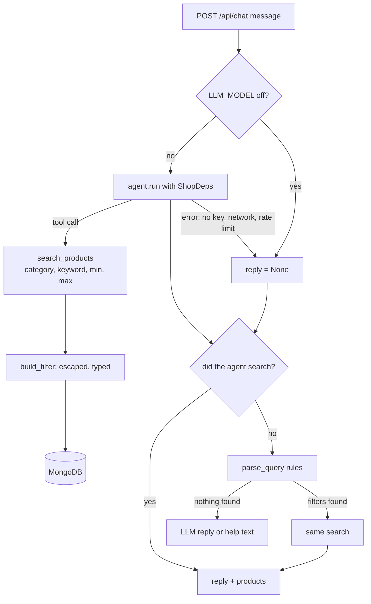

# High-Level Design

---

## 1. Purpose and scope

ClothStore demonstrates a complete, production-shaped web application that a single engineer can run, read and explain end to end: catalogue browsing, cart, checkout, order history, an admin back office, and an LLM shopping assistant that converts natural language into a safe, structured database query.

---

## 2. System context

The OpenAI Image API is used **once, offline from the app**, to create the photos. The running store never calls it.

---

## 3. Architecture

### 3.1 Container view

**One process, one origin.** FastAPI serves the API under `/api` and the storefront and photos under `/`. There is no CORS configuration and the frontend uses relative URLs.

### 3.2 Components and responsibilities

| Component                                       | Responsibility                                                | Key design choice                                                                                                                                                                                   |
| ----------------------------------------------- | ------------------------------------------------------------- | --------------------------------------------------------------------------------------------------------------------------------------------------------------------------------------------------- |
| **Frontend SPA** (`frontend/`)          | Rendering, routing, user interaction                          | No framework or build step. Pages are functions that render template strings. Every interpolated value passes through `escapeHtml`. One delegated click handler serves all "Add to cart" buttons. |
| **API layer** (`backend/routes/*`)      | HTTP contracts, validation, business rules                    | FastAPI and Pydantic models validate every input. Routers are thin, with business rules in small pure helpers (`build_filter`, `load_cart`, `parse_query`).                                   |
| **Data access** (`backend/database.py`) | MongoDB client, `get_db` dependency, id conversion, indexes | The database is injected per request (`Depends(get_db)`), so tests replace it with mongomock in one line.                                                                                         |
| **Security** (`backend/security.py`)    | Admin authorisation                                           | A shared-secret header (`X-Admin-Key`) compared in constant time and applied declaratively to write routes.                                                                                       |
| **AI agent** (`backend/routes/chat.py`) | Natural language to product search                            | The LLM gets exactly one typed tool and no raw query access. A deterministic parser is the fallback and safety net.                                                                                 |
| **Seeder** (`backend/seed.py`)          | First-run demo catalogue                                      | Deterministic (fixed RNG seed). Real photos (generated once, stored as files) where present, else self-contained SVG data URLs, so it needs no network.                                             |
| **Configuration** (`backend/config.py`) | Environment-driven settings                                   | 12-factor style: env vars, optional `.env`, a safe default for every value.

---

## 4. Key flow

### 4.1 Browse and add to cart

### 4.2 Checkout

The server re-reads the cart and live prices, copies a snapshot of each line into the order, writes the order, then clears the cart. The client never sends prices.

### 4.3 AI assistant with fallback

---

## 5. Data design

| Collection   | One document per              | Key fields                                                            | Indexes                                   |
| ------------ | ----------------------------- | --------------------------------------------------------------------- | ----------------------------------------- |
| `products` | product                       | name, description, price (int ₹), category, sizes[], colors[], image | `{category, price}`                     |
| `cart`     | (session, product, size) line | session_id, product_id, size, quantity                                | unique `{session_id, product_id, size}` |
| `orders`   | order                         | session_id, items[] (price snapshot), total, status, created_at       | `{session_id, created_at desc}`         |

---

## 6. Technology decisions

| Concern           | Choice                                                                         | Alternatives considered                     | Why                                                                                                                                                                          |
| ----------------- | ------------------------------------------------------------------------------ | ------------------------------------------- | ---------------------------------------------------------------------------------------------------------------------------------------------------------------------------- |
| Web framework     | FastAPI                                                                        | Flask, Django                               | Type-driven validation, automatic OpenAPI docs at `/docs`, async support for the LLM call, dependency injection used by the tests.                                         |
| Database          | MongoDB (pymongo)                                                              | PostgreSQL, SQLite                          | Matches the document-shaped data, flexible during iteration, and the "text-to-NoSQL" theme of the project. SQLite would remove the install step but lose that learning goal. |
| Frontend          | Vanilla ES modules                                                             | React, Vue                                  | No toolchain to install or explain. About 600 lines of JS. Modules give structure without a framework.                                                                       |
| LLM orchestration | Pydantic AI                                                                    | LangChain, raw SDK                          | Typed tools from Python signatures, dependency injection into tools, provider-agnostic model strings (Groq, Ollama, OpenAI…), and first-class test models.                  |
| Images            | Local `uploads/` folder, `frontend/images/products/` photos, SVG data URLs | Base64 in MongoDB (the original design), S3 | Keeps documents small, works offline, and is simple to back up.                                                                                                              |

