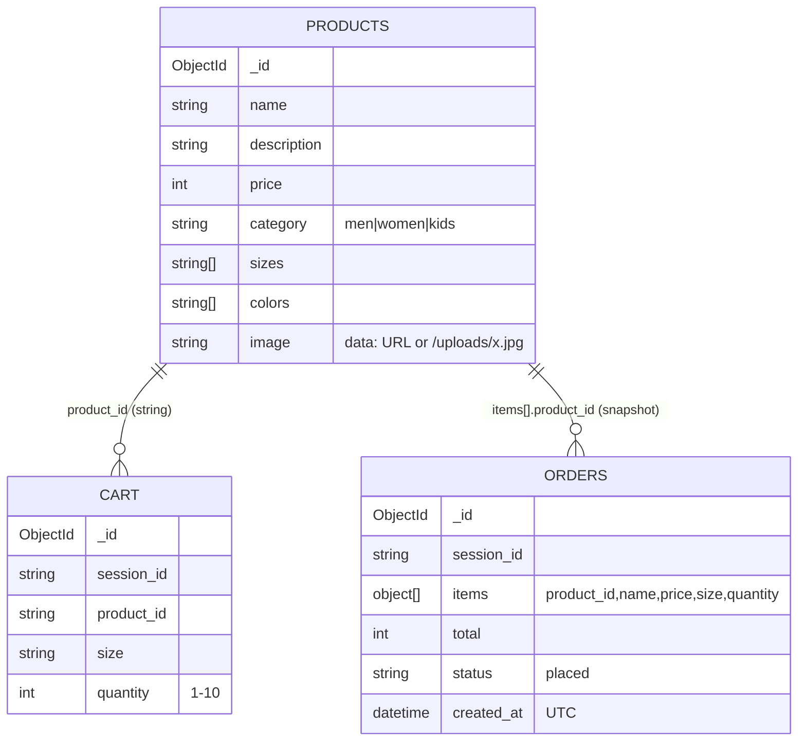
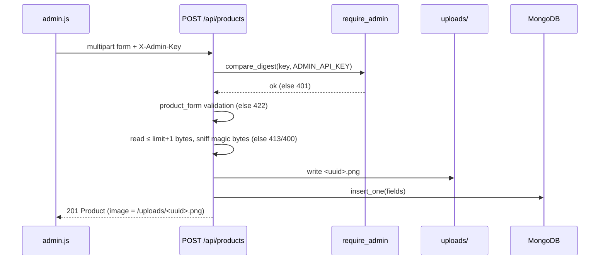
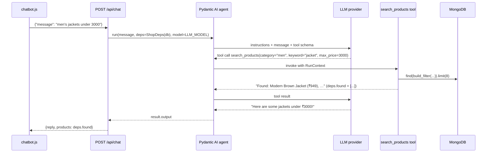

# Low-Level Design

---

## 1. Repository layout

```
ChatCloset
├── .env.example
├── .gitignore
├── .python-version
├── docker-compose.yml
├── Dockerfile
├── LICENSE
├── main.py                             lifespan (seed), 3 routers, /uploads + / static mounts
├── pyproject.toml
├── pytest.ini                          settings for the tests
├── README.md
├── requirements.txt
├── uv.lock
├── .github/workflows/ci.yml            Testing the UT 
├── backend/                            the shop assistant (Python)
│   ├── __init__.py
│   ├── config.py                       MONGO_URI, MONGO_DB, UPLOAD_DIR, MAX_UPLOAD_BYTES
│   ├── database.py                     client (tz_aware), db, get_db(), serialize(), to_object_id()
│   ├── models.py                       Category, MAX_QUANTITY, Product, ProductPage, CartAdd, CartUpdate, CartLine, Cart, OrderLine, Order
│   ├── security.py                     require_admin dependency (X-Admin-Key)
│   ├── seed.py
│   └── routes/
│       ├── __init__.py
│       ├── cart.py                     SessionId, load_cart, get, add, set quantity
│       ├── chat.py                     Pydantic AI agent, search tool, parse_query fallback
│       ├── orders.py                   checkout, list
│       └── products.py                 build_filter, list, get, product_form, detect_image_type, save_image,...
├── frontend/                           the shop window
│   ├── index.html
│   ├── images/products/*.webp
│   ├── css/style.css
│   └── js/
│       ├── api.js                      request(), errorText(), query(), json(), api.{…}
│       ├── main.js                     boot + delegated [data-add] handler
│       ├── router.js                   regex routes → page functions
│       ├── state.js                    sessionId
│       ├── ui.js                       escapeHtml, formatPrice, toast, productCard
│       ├── components/header.js        renderHeader, updateCartCount
│       ├── components/chatbot.js 
│       └── pages/
│           ├── admin.js
│           ├── cart.js
│           ├── home.js
│           ├── orders.js
│           └── product.js
├── scripts/                            Generate images
│   └── generate_product_images.py
└── tests/
    ├── conftest.py
    └── test_ai_and_security.py
```

---

## 2. API specification

Base path `/api`. JSON unless stated otherwise. Errors use FastAPI's shape `{"detail": "text"}`, or for 422 errors
`{"detail": [{"loc": […], "msg": "…", …}]}`. Interactive version: `/docs`.

| #  | Method & path                          | Auth  | Request                                                                                                                                                                      | Success                             | Errors                                 |
| -- | -------------------------------------- | ----- | ---------------------------------------------------------------------------------------------------------------------------------------------------------------------------- | ----------------------------------- | -------------------------------------- |
| 1  | `GET /products`                      | –    | query:`category` (men/women/kids), `q` (≤50), `min_price`, `max_price` (≥0), `sort` (newest/price_asc/price_desc), `page` (≥1), `limit` (1–48, default 12) | 200`ProductPage`                  | 422 invalid params                     |
| 2  | `GET /products/{id}`                 | –    | –                                                                                                                                                                           | 200`Product`                      | 404                                    |
| 3  | `POST /products`                     | admin | multipart:`name` (2–80), `description` (≤500), `price` (1–1,000,000), `category`, `sizes` ("S,M"), `colors` ("Red,Blue"), `image` (file, optional)          | 201`Product`                      | 401, 400 bad image, 413 too large, 422 |
| 4  | `PUT /products/{id}`                 | admin | same as#3; missing `image` keeps the current one                                                                                                                           | 200`Product`                      | 401, 404, 400, 413, 422                |
| 5  | `DELETE /products/{id}`              | admin | –                                                                                                                                                                           | 204                                 | 401, 404                               |
| 6  | `POST /products/reset-demo`          | admin | –                                                                                                                                                                           | 200`{"message", "count"}`         | 401                                    |
| 7  | `GET /cart/{session_id}`             | –    | –                                                                                                                                                                           | 200`Cart`                         | 422 bad session id                     |
| 8  | `POST /cart/{session_id}/items`      | –    | `CartAdd {product_id, size, quantity=1 (1–10)}`                                                                                                                           | 200`Cart`                         | 404, 400 size, 422                     |
| 9  | `PUT /cart/{session_id}/items`       | –    | `CartUpdate {product_id, size, quantity (0–10)}`                                                                                                                          | 200`Cart`                         | 422                                    |
| 10 | `POST /orders/{session_id}/checkout` | –    | –                                                                                                                                                                           | 201`Order`                        | 400 empty cart                         |
| 11 | `GET /orders/{session_id}`           | –    | –                                                                                                                                                                           | 200`Order[]` (≤50, newest first) | 422                                    |
| 12 | `POST /chat`                         | –    | `ChatRequest {message (1–500)}`                                                                                                                                           | 200`ChatResponse`                 | 422                                    |
| 13 | `GET /health`                        | –    | –                                                                                                                                                                           | 200 / 503                           | –                                     |


---

# 3. Data model

### 3.1 Collections



`product_id` is stored as a string, the same form the API exposes. Orders deliberately duplicate the name
and price, because an order is a historical record and must not change when the catalogue does.

### 3.2 Indexes

| Collection | Index                                                        | Serves                                                   |
| ---------- | ------------------------------------------------------------ | -------------------------------------------------------- |
| products   | `{category: 1, price: 1}`                                  | category pages and price bands (the most common filters) |
| cart       | `{session_id: 1, product_id: 1, size: 1}` **unique** | cart reads by session, and one line per product+size     |
| orders     | `{session_id: 1, created_at: -1}`                          | order history, sorted, without an in-memory sort         |

### 3.3 Pydantic schemas (`models.py`)

| Model                   | Fields                                                                               |
| ----------------------- | ------------------------------------------------------------------------------------ |
| `Category`            | `Literal["men", "women", "kids"]`                                                  |
| `Product`             | id, name, description, price:int, category, sizes:list[str], colors:list[str], image |
| `ProductPage`         | items:list[Product], total, page, pages                                              |
| `CartAdd`             | product_id, size, quantity:int = 1 (1 ≤ q ≤ 10)                                    |
| `CartUpdate(CartAdd)` | quantity:int (0 ≤ q ≤ 10, required)                                                |
| `CartLine`            | product_id, name, image, price, size, quantity, line_total                           |
| `Cart`                | items:list[CartLine], total, count                                                   |
| `OrderLine`           | product_id, name, price, size, quantity                                              |
| `Order`               | id, items:list[OrderLine], total, status, created_at:datetime                        |
| `ChatRequest`         | message:str (1–500)                                                                 |
| `ChatResponse`        | reply:str, products:list[Product]                                                    |

`response_model` filters internal fields such as `session_id` out of every response.

---

## 4. Sequence diagrams

### 4.1 Admin creates a product with an image



### 4.2 Chat with tool call




---

## 5. Error handling matrix

| Layer          | Error                                            | Result                                                                            |
| -------------- | ------------------------------------------------ | --------------------------------------------------------------------------------- |
| Validation     | bad query/body/form                              | 422 with field messages, shown in a toast                                         |
| Domain         | unknown product, empty cart, bad size, bad image | 404 / 400 / 413 with a human-readable`detail`                                   |
| Auth           | missing/wrong admin key                          | 401. The frontend forgets the key and shows the sign-in form.                     |
| Infrastructure | MongoDB unreachable                              | startup abort, or JSON 500 at runtime; health returns 503                         |
| LLM            | any exception                                    | warning log + keyword fallback (never an HTTP error)                              |
| Unexpected     | any other exception                              | JSON 500, with the traceback in the log                                           |
| Frontend       | network/JSON failure                             | `Request failed (status)` toast, or the error message rendered in the page area |
