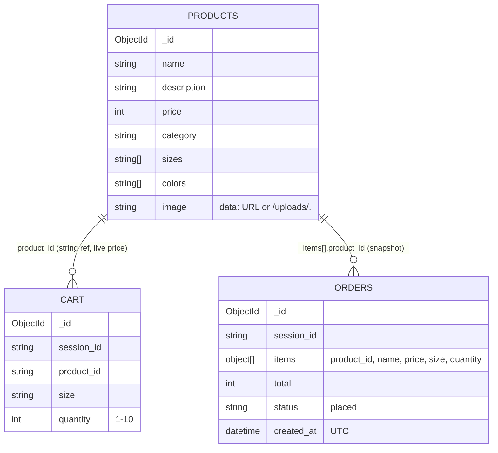

# Low-Level Design

---

## 1. Repository layout

```
├── .env.example
├── .gitignore
├── .python-version
├── LICENSE
├── main.py                             lifespan (seed), 3 routers, /uploads + / static mounts
├── pyproject.toml
├── pytest.ini                          settings for the tests
├── README.md
├── uv.lock
├── requirements.txt
├── backend/                            the shop assistant (Python)
│   ├── __init__.py
│   ├── config.py                       MONGO_URI, MONGO_DB, UPLOAD_DIR, MAX_UPLOAD_BYTES
│   ├── database.py                     client (tz_aware), db, get_db(), serialize(), to_object_id()
│   ├── models.py                       Category, MAX_QUANTITY, Product, ProductPage, CartAdd, CartUpdate, CartLine, Cart, OrderLine, Order
│   ├── seed.py
│   └── routes/
│       ├── __init__.py
│       ├── cart.py                     SessionId, load_cart, get, add, set quantity
│       ├── orders.py                   checkout, list
│       └── products.py                 build_filter, list, get, product_form, detect_image_type, save_image,...
├── frontend/                           the shop window
│   ├── index.html
│   ├── images/products/*.webp
│   ├── css/style.css
│   └── js/
│       ├── api.js                      request(), errorText(), query(), json(), api.{…}
│       ├── app.js
│       ├── main.js                     boot + delegated [data-add] handler
│       ├── router.js                   regex routes → page functions
│       ├── state.js                    sessionId
│       ├── ui.js                       escapeHtml, formatPrice, toast, productCard
│       ├── components/header.js        renderHeader, updateCartCount
│       └── pages/
│           ├── admin.js
│           ├── cart.js
│           ├── home.js
│           ├── orders.js
│           └── product.js
├── scripts/                            Generate images
│   └── generate_product_images.py
└── tests/
    ├── conftest.py
    └── test_catalog.py
```

---

## 2. API specification

Base path `/api`. Errors are `{"detail": "…"}`, or `{"detail": [{loc, msg, type}]}` for 422. Unhandled errors are a 500 `text/plain`.

| #  | Method & path                          | Request                                                                                                                                                      | Success                  | Errors             |
| -- | -------------------------------------- | ------------------------------------------------------------------------------------------------------------------------------------------------------------ | ------------------------ | ------------------ |
| 1  | `GET /products`                      | `category`, `q` (≤ 50), `min_price`, `max_price` (≥ 0), `sort` (newest / price_asc / price_desc), `page` (≥ 1), `limit` (1–48, default 12) | 200 `ProductPage`      | 422                |
| 2  | `GET /products/{id}`                 | –                                                                                                                                                           | 200 `Product`          | 404                |
| 3  | `POST /products`                     | multipart: `name`, `description`, `price`, `category`, `sizes`, `colors`, `image?`                                                             | 201 `Product`          | 400, 413, 422      |
| 4  | `PUT /products/{id}`                 | same as #3 (a missing `image` keeps the current one)                                                                                                       | 200 `Product`          | 400, 404, 413, 422 |
| 5  | `DELETE /products/{id}`              | –                                                                                                                                                           | 204                      | 404                |
| 6  | `POST /products/reset-demo`          | –                                                                                                                                                           | 200 `{message, count}` | –                 |
| 7  | `GET /cart/{session_id}`             | –                                                                                                                                                           | 200 `Cart`             | 422                |
| 8  | `POST /cart/{session_id}/items`      | JSON `CartAdd`                                                                                                                                             | 200 `Cart`             | 400, 404, 422      |
| 9  | `PUT /cart/{session_id}/items`       | JSON `CartUpdate`                                                                                                                                          | 200 `Cart`             | 422                |
| 10 | `POST /orders/{session_id}/checkout` | –                                                                                                                                                           | 201 `Order`            | 400, 422           |
| 11 | `GET /orders/{session_id}`           | –                                                                                                                                                           | 200 `Order[]`          | 422                |


---

# 3. Data model

